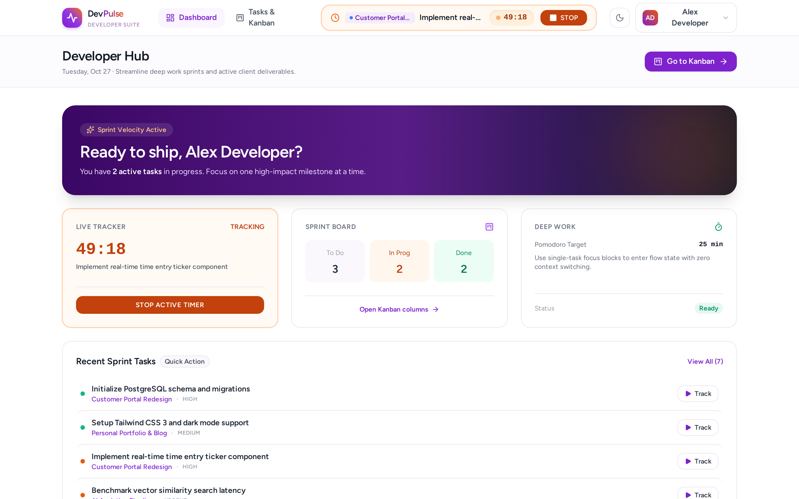
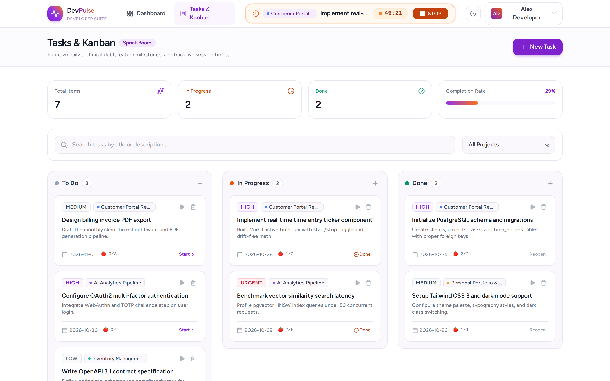
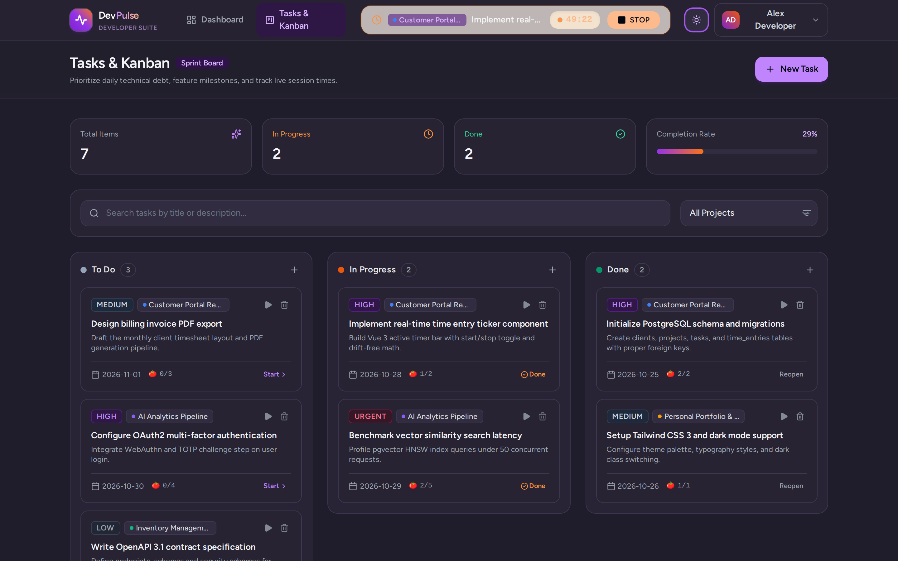
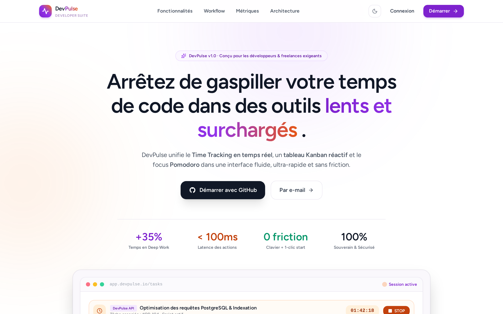

<p align="center">
  <br />
  <h1 align="center">⚡ DevPulse</h1>
  <p align="center">
    <strong>La suite de productivité haute vélocité conçue pour les développeurs & freelances exigeants.</strong>
  </p>
  <p align="center">
    Chronomètre en temps réel · Tableau Kanban de sprint · Focus Pomodoro · GitHub OAuth · API REST v1
  </p>
</p>

<p align="center">
  
  
  
  
  
  
  
  
  
</p>

---

## 📸 Aperçu de l'Interface

<p align="center">
  
  <br />
  <em>Tableau de bord haute vélocité avec chronomètre actif en temps réel, métriques de sprint et répartition de charge</em>
</p>

<p align="center">
  
  <br />
  <em>Tableau Kanban avec priorités visuelles, chronomètre 1-clic intégré et filtres de sprint</em>
</p>

<p align="center">
  
  <br />
  <em>Thème sombre doux « Soft Dark » sans fatigue visuelle pour les sessions de code tardives</em>
</p>

<p align="center">
  
  <br />
  <em>Page d'accueil conçue pour la conversion avec aperçu interactif et connexion GitHub 1-clic</em>
</p>

---

## 💡 Pourquoi DevPulse ?

La plupart des outils de gestion de projet (Jira, ClickUp) sont lents, surchargés et consomment des ressources disproportionnées. Les minuteurs tiers (Toggl, Clockify) nécessitent des manipulations permanentes qui coupent le flot de concentration.

**DevPulse unifie tout en une interface ultra-rapide (< 100ms) sans rechargement de page** :
1. **Chronomètre Atomique en Direct** : toujours accessible dans la barre supérieure, déclenchable au clavier ou d'un clic sur n'importe quelle tâche.
2. **Tableau Kanban Réactif** : 3 colonnes de flux (`À Faire`, `En Cours`, `Terminé`), gestion des priorités et filtre instantané par projet.
3. **Moteur Pomodoro Anti-Burnout** : sessions calibrées de 25 minutes avec calcul des tomates estimées versus réalisées.
4. **Authentification 1-Clic GitHub OAuth** : inscription instantanée, sans mot de passe à retenir et avec synchronisation automatique de l'avatar.
5. **Charte Graphique « Plum & Peach »** : fond blanc haute lisibilité par défaut, respect des contrastes WCAG AA et thème sombre doux pour travailler tard sans fatigue oculaire.

---

## 🏛️ Architecture & Clean Code

DevPulse respecte strictement les principes de conception logicielle moderne :
* **Thin Controllers** : les contrôleurs HTTP se contentent d'adapter la requête et délèguent immédiatement à des **Actions métier** (`app/Actions/*`).
* **Verrous de Concurrence (`lockForUpdate`)** : démarrage d'un chrono encapsulé dans une transaction atomique PostgreSQL pour empêcher tout doublon de session.
* **DTOs & Typage Strict** : objets de transfert de données immutables pour garantir l'intégrité entre l'API et le domaine.
* **API Versionnée (`/api/v1`)** : couverte par Laravel Sanctum et documentée selon la spécification OpenAPI à l'adresse `/docs/api`.

---

## 🚀 Démarrage Rapide

### Option A — Avec Docker (Recommandé, 1 seule commande)

Prérequis : [Docker](https://docs.docker.com/get-docker/) et Docker Compose installés.

```bash
# 1. Cloner le dépôt
git clone https://github.com/votre-compte/devpulse.git
cd devpulse

# 2. Démarrer l'ensemble des conteneurs (App, PostgreSQL 17, Redis, Mailpit)
docker compose up -d

# 3. Ouvrir dans votre navigateur
# Application : http://localhost:8001
# Mailpit (Webmail test) : http://localhost:8025
```

Le script d'entrée Docker initialise automatiquement le fichier `.env`, génère la clé `APP_KEY`, attend la disponibilité de PostgreSQL et exécute les migrations.

---

### Option B — Installation Locale Classique

Prérequis : PHP 8.3+, Composer, Node.js 22+, PostgreSQL 17.

```bash
# 1. Cloner et installer les dépendances
git clone https://github.com/votre-compte/devpulse.git
cd devpulse
composer install
npm install

# 2. Configurer l'environnement
cp .env.example .env
php artisan key:generate

# 3. Configurer vos identifiants PostgreSQL dans .env, puis migrer :
php artisan migrate

# 4. Compiler les assets et démarrer les serveurs
npm run build
php artisan serve --port=8001
```

Rendez-vous sur [http://localhost:8001](http://localhost:8001).

---

## 🔑 Configuration GitHub OAuth (Optionnelle)

Pour activer la connexion en 1 clic avec GitHub :
1. Créez une OAuth App sur [github.com/settings/applications/new](https://github.com/settings/applications/new).
2. Définissez l'URL de rappel (*Authorization callback URL*) sur :
   `http://localhost:8001/auth/github/callback`
3. Renseignez vos identifiants dans votre `.env` :
   ```env
   GITHUB_CLIENT_ID=votre_client_id
   GITHUB_CLIENT_SECRET=votre_client_secret
   GITHUB_REDIRECT_URI=http://localhost:8001/auth/github/callback
   ```

---

## 🧪 Tests & Qualité de Code

Le projet est livré avec une suite complète de **56 tests automatisés (Feature & Unit)** :

```bash
# Lancer la suite de tests complète
php artisan test --compact

# Vérifier la conformité du style de code (Laravel Pint)
vendor/bin/pint --test

# Vérifier le typage TypeScript et la compilation des assets Vite
npm run build
```

---

## 📖 Documentation de l'API

Une documentation OpenAPI / Swagger interactive complète est intégrée nativement dans l'application :
* **Interface interactive** : [http://localhost:8001/docs/api](http://localhost:8001/docs/api)
* **Spécification JSON brute** : [http://localhost:8001/docs/api.json](http://localhost:8001/docs/api.json)

---

## 📦 Stack Technique

| Domaine | Technologie |
|---|---|
| **Backend** | PHP 8.3 · Laravel 11.x · Laravel Sanctum · Laravel Socialite |
| **Frontend** | Vue 3 (Composition API) · Inertia.js v2 · TypeScript · Pinia · Tailwind CSS v3 |
| **Base de Données** | PostgreSQL 17 (Indexation JSONB & foreign keys optimisées) |
| **Cache & Files** | Redis |
| **Outillage & Qualité** | PHPUnit 12 · Laravel Pint · vue-tsc · Vite 8 · Lucide Icons |
| **Conteneurisation** | Docker multi-stage · Docker Compose |

---

## 🤝 Contribution & Licence

Les contributions sont les bienvenues ! Pour proposer une amélioration :
1. Forkez le projet.
2. Créez une branche dédiée (`git checkout -b feature/nouvelle-fonctionnalite`).
3. Assurez-vous que tous les tests passent (`php artisan test`).
4. Committez vos modifications selon la convention *Conventional Commits*.
5. Ouvrez une Pull Request.

Distribué sous licence **MIT**. Voir `LICENSE` pour plus d'informations.
